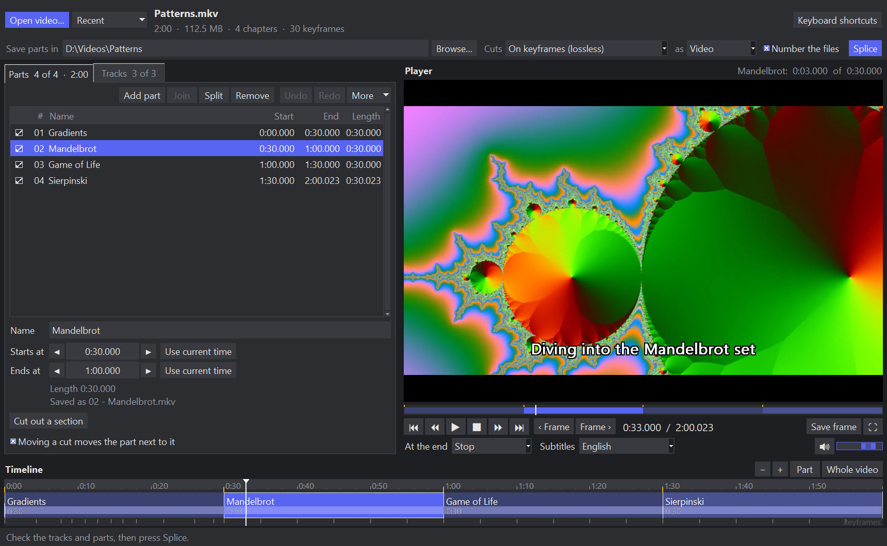
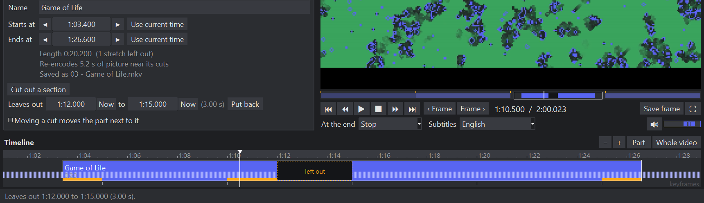
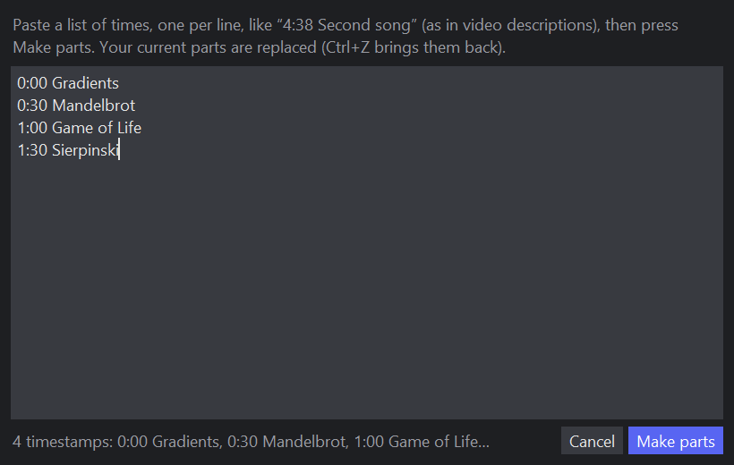

# Splicer

Splits a video into separate files without re-encoding it. Open a video, its
chapters show up as parts, you adjust them while you watch, then hit **Splice**.



Each part is a straight copy of the original: same picture, same sound, same
subtitles, written in seconds even for 4K. If you need to cut somewhere other
than a keyframe, Splicer can re-encode just the frames next to that cut and
copy the rest.

Windows only. Nothing goes online.

## Get it

Download `Splicer.exe` from the
[latest release](https://github.com/phillram/splicer/releases/latest) and run
it. Nothing else to install. You can also drop a video onto the exe.

Or from source (Python 3.10+):

```
pip install -r requirements.txt
python -m splicer
```

## Using it

1. **Open video…**, or drop one on the window.
2. On the **Tracks** tab, check the audio and subtitle tracks you want. The
   defaults are already checked.
3. On the **Parts** tab, fix up the parts. Chapters become parts; with no
   chapters you get one part to split up.
4. Pick where to save, and hit **Splice**.

To change a part, select it and type new start and end times, or press
**Use current time** (or `I` / `O`) while watching, or drag its edges on the
timeline. **Add part**, **Split** and **Remove** do what they say. Uncheck a
part to skip it; Shift+click a checkbox to check or uncheck every part up to
the last one you clicked. Everything can be undone with `Ctrl+Z`.

The timeline along the bottom shows the sound's waveform, which makes the gaps
between songs or scenes easy to spot. `Ctrl+wheel` zooms in.

Splicer remembers your parts for each video, so you can close it and carry on
later.

### Cutting a bit out, or joining parts

Select a part, play to where the bit you don't want starts, and hit **Cut out
a section**. Nothing changes yet: play on to where it ends and hit **End the
cut here** (or **Cancel**). The timeline shows it as a dark "left out" block,
and the part is saved as one file with that bit removed.

Adjust its times by typing, with **Now**, or by dragging its edges on the
timeline. Taking its start past its end (or its end before its start) moves
the whole stretch along, keeping its length.

To join parts into one file, Ctrl+click them in the list and hit **Join**.



### Keyframes or anywhere

The **Cuts** setting at the top decides where a cut can go:

- **On keyframes (lossless)**: the default. Every part is an exact copy, but a
  cut can only land on a keyframe, which comes every few seconds in most
  videos. Times you type move to the nearest one.
- **Anywhere**: cut on any frame. The picture between each cut and its nearest
  keyframe (usually a second or two) is re-encoded at very high quality in the
  same format. The rest of the picture, and all of the sound, is still copied.
  The re-encoded bits show in orange on the timeline. Works with H.264, HEVC,
  AV1, VP9, VP8, MPEG-2 and MPEG-4.

### Timestamps

If a video has no chapters but you have a list of times (like the ones in
YouTube descriptions), use **More ▸ Parts from timestamps…**. If the video's
own description has one, it's filled in for you.



### Saving

- Parts go in a folder named after the video unless you pick another.
- **Number the files** gives you `01 - Intro.mkv`, `02 - …`.
- A part that spans several of the original chapters keeps them.
- **Save as: Sound only** saves just the audio, untouched (`.opus`, `.m4a`,
  `.mp3`, `.flac` and so on), numbered like album tracks.
- **Save frame** (`S`) saves the current picture as a full-size PNG.

### Keyboard shortcuts

| Key | |
|---|---|
| Space | Play / pause |
| ← → | Back / forward 5 seconds |
| , . | Back / forward one frame |
| Ctrl+← Ctrl+→ | Previous / next keyframe |
| Home End | Start / end of the part |
| Page Up / Page Down | Previous / next part |
| I O | Set the part's start / end to now |
| Ctrl+Z Ctrl+Y | Undo / redo |
| Ctrl+A | Select every part |
| + − | Zoom the timeline |
| F, Esc | Full screen, leave it |
| M | Mute |

## Building

```
pip install -r requirements.txt pyinstaller pytest
python -m pytest tests
python tools/build_exe.py
```
